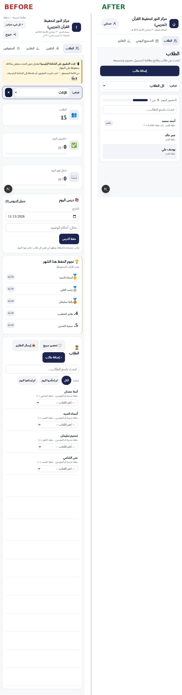
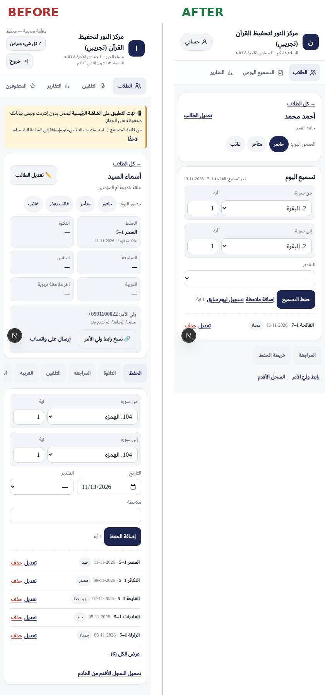
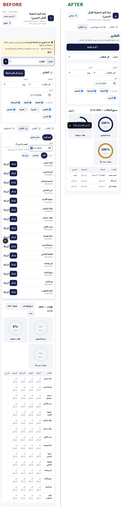

# تسليم: تبسيط تطبيق منارات (حسب `docs/SIMPLIFY-PROMPT.md`)

الفرع: `claude/bold-heisenberg-728ypv` · كل بند في commit مستقل · بعد كل مرحلة نجحت: `npm run test:db` (138 ناجحًا) و`tsc` و`eslint` و`next build`.

## ملاحظات العميل

| # | الملاحظة | الحالة | ماذا تغيّر |
|---|---|---|---|
| — | المنصة تبدأ فارغة | نُفّذت | ملف أساسي واحد للقاعدة (`20261113000000_manarat_baseline.sql`) بلا «المركز الأول» ولا `first_center_id`؛ الاختبارات تبدأ من قاعدة فارغة وتتأكد منها؛ النسخة التجريبية: حسابات الدخول ومركزان فارغان فقط. العزل بين المراكز (RLS) كما هو ومغطّى بالاختبارات. |
| 1 | الفصحى في كل الواجهة | نُفّذت | «انبعت» ← «أُرسل»، «مش مسجّل» ← «غير مسجّل»، «ادخل للتطبيق» ← «الدخول إلى التطبيق»، «عندك» ← «لديك»، «لازم» ← «يجب»، «صار» ← «أصبح»، وشرح النسب في المتفوقين. |
| 2 | «السلام عليكم» بدل صباح/مساء الخير | نُفّذت | `AppShell.tsx`. |
| 3 | «حفظ» بدل «مزامنة» | نُفّذت | «تم الحفظ ✓» / «جارٍ الحفظ…» / «محفوظ على الجهاز، سيُحفظ في الحساب عند الاتصال»؛ لا كلمة «مزامنة» في الواجهة. الآلية (outbox) لم تتغيّر. |
| 4 | التلقين اختياري | نُفّذت | migration `20261113000200_center_tracks.sql`: `centers.enabled_tracks` (الافتراضي: الحفظ + المراجعة) و`talqeen_label`؛ الإدارة ← «مسارات المتابعة»؛ المسار غير المفعّل يختفي من القائمة والبطاقة والتقارير ورابط وليّ الأمر؛ 11 اختبارًا. |
| 5 | التقارير للإدارة | نُفّذت | migration `20261113000300_reports_to_admin.sql`: جدول `circle_reports` و`centers.guardian_whatsapp` (مُطفأ)؛ زر واحد «إرسال للإدارة»؛ «التقارير الواردة» عند المدير؛ لا طلب لرقم وليّ الأمر ولا رسائل «بدون رقم» ما لم تُفعّل الإدارة واتساب؛ 11 اختبارًا. |
| 6 | «السجل الشهري» بدل «آيات الشهر» | نُفّذت | لوحة المدير. |
| 7 | الحفظ بالسورة | نُفّذت | `Mushaf.describeSurahs()`: «سورة الكهف كاملة + 20 آية من مريم»، «3 سور كاملة»؛ في خريطة الحفظ ونجوم الحفظ ورابط وليّ الأمر واللوحة. البيانات تبقى بالآيات. |
| 8 | تأكيد كلمة المرور و👁 | نُفّذت | `PasswordInput` في كل حقول كلمة المرور؛ «تأكيد كلمة المرور» مع رسالة التطابق في التسجيل وتعيين كلمة مرور جديدة وتغيير كلمة مرور المحفّظ (بدل `prompt()`). |
| 9 | السرعة | نُفّذت | قِيس أولًا (التفاصيل في `docs/PERFORMANCE.md`): الدخول 13.2 ث والخروج 7.1 ث على Netlify. السبب: ~20 طلب سحب متتالية قبل أول شاشة، والخروج يسحب كل شيء. بعد: سحب متوازٍ، السور مضمّنة، فتح فوري من النسخة المحفوظة، خروج يرسل المعلّق فقط → محليًا 0.66 ث للدخول و0.26 ث للخروج. على Netlify يبقى زمن تشغيل الدالة الباردة. |

## ما أُزيل من الواجهة وأين صار

| أُزيل من | ما هو | أين صار |
|---|---|---|
| القائمة العلوية | المتفوقون، اللوحة، سجل المحذوفات، سجل التعديلات | أقسام داخل «الإدارة» (نظرة عامة، المتفوقون، المركز والإعدادات، سجل المحذوفات، سجل التعديلات) |
| القائمة العلوية | التلقين | يظهر فقط إن فعّله المركز (وباسمه، مثل «التسميع») |
| صفحة الطلاب | درس اليوم، تحضير سريع، نجوم الحفظ، تنبيه الغياب، جاهزون للاختبار | شاشة «التسميع اليومي» الجديدة |
| صفحة الطلاب | إرسال التقارير | «التقارير» ← «إرسال للإدارة» |
| صفحة الطلاب | 3 بطاقات إحصاء | سطر صغير واحد «الحضور اليوم» |
| صفحة الطلاب | اختيار الكتاب لكل طالب في القائمة | تبويب «العربية» في بطاقة الطالب |
| رأس التطبيق | اسم المستخدم، شارة الحفظ، الإشعارات، تبديل المركز، المنصة، خروج، السطر الميلادي | زر واحد «حسابي» بقائمة صغيرة (شارة الحفظ تظهر في الرأس فقط إن بقي شيء لم يُحفظ) |
| بطاقة الطالب | شبكة 6 مربعات للمسارات | مربع واحد «تسميع اليوم» + تبويبات مغلقة لباقي المسارات المفعّلة |
| بطاقة الطالب | مربع وليّ الأمر الكبير | رابط صغير «رابط وليّ الأمر» في آخر البطاقة |
| التقارير | أزرار نسخ وطباعة وCSV | «⋯ المزيد» |
| اللافتات | «أكمل إعداد مركزك» و«ثبّت التطبيق» في كل زيارة | الأولى للمدير مرة واحدة (و«إغلاق»)، والثانية مرة واحدة في الزيارة الثالثة |

جديد للوضوح: سطر يشرح كل شاشة تحت عنوانها، وشاشة ترحيب لمركز فارغ بثلاث خطوات (أضف حلقة ← أضف طلابها ← ادعُ معلّمًا).

## لقطات قبل وبعد (جوال 390px)

| الطلاب | بطاقة الطالب | إرسال التقارير |
|---|---|---|
|  |  |  |

«قبل» من النسخة التجريبية القديمة ببيانات وهمية (15 طالبًا)، و«بعد» من النسخة الجديدة التي تبدأ فارغة (حلقة بثلاثة طلاب أُضيفت للتجربة).
